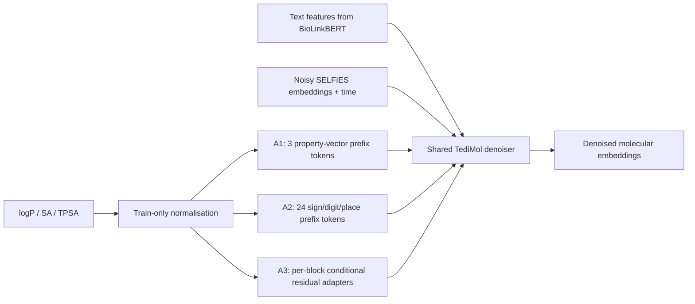

# TediMol Property Fusion

[](https://github.com/kk121605/TediMol-Property-Fusion/actions/workflows/checks.yml)

**Ongoing research on text- and numerical-property-conditioned molecular diffusion.** This repository contains the second-stage code from my research-group project, comparing three property-fusion routes with a shared text-only control on the supplied TediMol backbone.

**Contributor: Yikun Luo (罗毅坤).** My work focuses on implementing and integrating the second-stage conditioning routes, controlled branch comparisons, checkpoint continuation, diagnostics and evidence verification. The TediMol backbone and the supplied JoPMol-style reference come from the research group. The underlying frameworks and the methods that inspired these extensions are credited below.

## Four branches, one shared backbone

| Branch | Implementation | Extra condition positions | Research status |
| --- | --- | ---: | --- |
| **A0c** `a0c` | Text-only continued-training control | 0 | 1.2M stage-2 updates and a verified 2,795-example test snapshot |
| **A1** `a1_prefix` | JoPMol-style scalar property vectors as a prefix | 3 | Historical 10k training receipt; control quality remains unestablished |
| **A2** `a2_rt_numeric` | Regression Transformer-inspired sign/digit/place prefix | 24 | Historical 10k training receipt; control quality remains unestablished |
| **A3** `a3_adaln_zero` | Graph DiT-inspired, zero-gated residual adapters after each block | 0 | Historical 10k training receipt; control quality remains unestablished |

Properties are ordered **logP, SA, TPSA**. Normalisation uses training statistics only. The three routes are adaptations of selected conditioning ideas, not complete reproductions of JoPMol, Regression Transformer or Graph DiT. Longer property-branch experiments remain ongoing; this local release does not establish their present remote state or a winning method.



A0c bypasses numerical conditioning. Only one branch is selected per run. See [the method comparison](docs/methods.md) for the architecture, position shifts and comparison limits.

## Run the actual code on CPU

Use **Python 3.11 or 3.12** in a virtual environment:

```bash
git clone https://github.com/kk121605/TediMol-Property-Fusion.git
cd TediMol-Property-Fusion
python -m venv .venv
# Linux/macOS
source .venv/bin/activate
# Windows PowerShell: .\.venv\Scripts\Activate.ps1
python -m pip install torch==2.5.1 --index-url https://download.pytorch.org/whl/cpu
python -m pip install -r requirements-cpu.txt
python portfolio.py
python -m unittest discover -s tests -v
```

The demo uses the **real recovered TediMol/BERT/diffusion code at reduced dimensions**, with random text features, token IDs and fixture properties. It runs one actual diffusion-loss/AdamW/EMA update for every branch. Tests also exercise 20-step diffusion sampling, prefix lengths, A3's zero-initialisation identity, numerical encoding, missing values, and exact optimizer/EMA continuation.

No pretrained encoder, research checkpoint, private dataset or model-hub download is needed. The outputs are software checks, not trained molecule generation or property-control results. The recovered code emits some historical diagnostic messages during execution.

## Verified text-only result snapshot

Both rows below use the same 2,795 test references, EMA, 200-step sampling and sampling seed 121. The second row continues from the first-stage model. Its 1.2M count refers to stage-2 updates, not total training from scratch.

| Metric | Stage 1: 300k | A0c: stage 2 at 1.2M |
| --- | ---: | ---: |
| Valid molecules | 2,789 / 2,795 | 2,792 / 2,795 |
| Exact canonical isomeric SMILES match | 14.3113% | 15.8497% |
| MACCS similarity | 0.7441 | 0.7550 |
| RDK similarity | 0.5949 | 0.6175 |
| Morgan similarity | 0.4851 | 0.5108 |
| Uniqueness among valid outputs | 99.2829% | 98.9255% |
| Novelty among unique valid outputs | 83.4958% | 81.7524% |

Structure matching increases in this snapshot, while uniqueness and novelty decrease. **A0c uses text only; these results do not demonstrate numerical-property control or statistically significant superiority.** Similarity averages use different valid-pair counts (2,789 and 2,792). FCD and Text2Mol were not run.

Recompute the reported metrics from the included two prediction CSVs:

```bash
python tools/evaluate_predictions.py
```

The verifier checks hashes and independently recomputes all core metrics for **5,590 predictions**. Novelty uses a SHA256 membership set derived from canonical training structures, without distributing the original training CSV. Dataset provenance and split-independence claims require additional auditing. Weights are not included; recorded checkpoint hashes do not constitute a fresh generation rerun. See [evidence and limitations](docs/research_status.md).

## Start reading here

- [A1 conditioning code](research/tedimol_s2/01_A1_TediMol加JoPMol属性前缀/a1_conditioning.py) and [fusion](research/tedimol_s2/01_A1_TediMol加JoPMol属性前缀/a1_fusion_model.py)
- [A2 conditioning code](research/tedimol_s2/02_A2_TediMol加RegressionTransformer数值编码/a2_conditioning.py) and [fusion](research/tedimol_s2/02_A2_TediMol加RegressionTransformer数值编码/a2_fusion_model.py)
- [A3 conditioning code](research/tedimol_s2/03_A3_TediMol加GraphDiT启发逐层调节/a3_conditioning.py) and [fusion](research/tedimol_s2/03_A3_TediMol加GraphDiT启发逐层调节/a3_fusion_model.py)
- [Shared training update and A0c route](research/tedimol_s2/00_common_base/comparison_runtime.py), [S2 training](research/tedimol_s2/00_common_base/train_s2.py), [sampling](research/tedimol_s2/00_common_base/sample_s2.py)
- [Reproduction guide](docs/reproducibility.md), [source provenance](docs/provenance.md), [ongoing-work boundaries](docs/research_status.md)

`research/` preserves the supplied executable source. `portfolio.py`, `tests/` and `tools/` provide portable publication checks. `archive/` contains selected continuation history that depends on the original deployment and is not a supported cluster-launch package. Original datasets, text caches, large weights, cluster account configuration, private reports and third-party papers are excluded.

## Acknowledgements

- **TediMol:** research-group-provided text-guided molecular diffusion backbone, described in the supplied manuscript *Bridging Language and Chemistry: Conditional Diffusion for Text-Guided Molecular Generation*. This repository does not assert its publication status or original authorship by the contributor.
- **JoPMol:** Yuan et al., *Gene Expression–Informed Jointly Controlled Generative Modeling for Precision Molecular Design*, [DOI:10.1145/3767308.3835669](https://doi.org/10.1145/3767308.3835669). A1 transfers the supplied property-prefix idea, not the complete multimodal framework.
- **Regression Transformer:** [Nature Machine Intelligence paper](https://www.nature.com/articles/s42256-023-00639-z), [official code](https://github.com/IBM/regression-transformer). A2 transfers signed digit/place conditioning and numerical encodings, not its XLNet training tasks.
- **Graph DiT:** *Graph Diffusion Transformers for Multi-Conditional Molecular Generation*, [arXiv:2401.13858](https://arxiv.org/abs/2401.13858), [official code](https://github.com/liugangcode/Graph-DiT). A3 adapts conditional shift/scale/gating into a SELFIES-sequence residual adapter, not graph diffusion.
- [TGM-DLM](https://github.com/Deno-V/tgm-dlm), [OpenAI improved-diffusion](https://github.com/openai/improved-diffusion), and [BioLinkBERT](https://huggingface.co/michiyasunaga/BioLinkBERT-base) supply method/code/encoder lineage.

Public release is authorised by the contributor. No blanket relicensing of inherited research-group code is asserted; see [NOTICE](NOTICE.md) and [third-party notices](third_party/).
